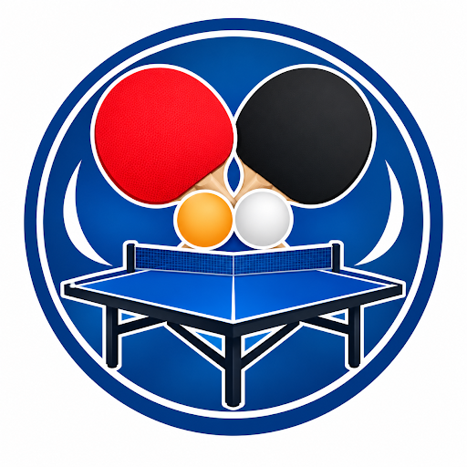

# Tienda
# Ping Pong Smash Table Tennis

# Descripcion

En Ping Pong Smash Table Tennis **(PPST)**, disponemos de 65 pabellones equipados en toda España para alquiler de mesas, espacios de juego y material deportivo adaptado al tennis de mesa.

### Problema que resuelve
El proceso manual de gestión de reservas genera incidencias como solapamiento de horarios y demoras en la atención al cliente. Este sistema automatizado mediante Inteligencia Artificial permite consultar la disponibilidad en tiempo real y tramitar las reservas de forma autónoma, rápida y sin errores de duplicidad.

## Servicios y Equipamientos

Ofrecemos instalaciones adaptadas tanto para la práctica libre como para el entrenamiento nivel profesional.

## Categoria de Reserva 

- **Mesa de Práctica**
    - Tarifa: 2€ / 30 minutos
    - Equipamiento: Incluye *Pack Práctica* con mayor cantidad de material de juego.
    - Garantia: 15 €
- **Mesa Profesional**
     - Tarifa: 4 € / 30 minutos
    - Equipamiento: Incluye *Pack Profesional* enfocado a un uso técnico.
    - Garantia: 20 €

## Datos Mínimos de la Reserva

| Dato | Descripción / Información |
| :--- | :--- |
| **Nombres y Apellidos** | Datos completos del cliente |
| **Teléfono** | Teléfono de contacto |
| **Correo electrónico** | Correo del cliente |
| **Fecha de reserva** | Día de la reserva |
| **Hora de inicio** | Hora a la que comienza la reserva |
| **Duración** | 30 min, 60 min o 90 min |
| **Tipo de mesa** | Mesa de práctica o mesa profesional |
| **Pack** | Pack Práctica o Pack Profesional |

### Duración y Horarios

 - Duración de las sesiones: 30, 60 o 90 minutos.
    - Horario de apertura: Lunes a sábado de 8:00 a 13:30 h y de 16:00 a 20:00 h **(Domingos cerrados).**

    *Condiciones de la garantía*: La garantía se devuelve íntegramente al finalizar la sesión. El cliente puede descontar de ella el material consumido o abonarlo por separado para recuperar la totalidad del importe.
    
## Sistema de Reserva

Las reservas se gestionan de forma automatizada mediante un **asistente de Inteligencia Artificial (IA)** integrado en nuestra plataforma web:

 1. **Consulta de disponibilidad**: El usuario indica el tipo de mesa, fecha, hora de inicio y duración deseada a través del chat.
 1. **Verificación instantánea**: El sistema comprueba la disponibilidad en la base de datos para evitar duplicidades de horario. En caso de no haber espacio libre, la IA sugerirá horarios o mesas alternativas.   
 1. **Datos requeridos**: Para formalizar la solicitud es necesario indicar nombre completo, número de teléfono y correo electrónico.
 1. **Confirmación**: Tras verificar los datos de la reserva, el cliente confirma la solicitud para finalizar el proceso.   

## Funcionalidades para el Personal

El personal de los pabellones dispone de acceso a la plataforma para las siguientes tareas:
- Consultar la lista de reservas confirmadas por el sistema en tiempo real.
- Gestionar la entrega y recepción de los packs de material asignados a cada reserva.
- Revisar el estado del material entregado y procesar la devolución de la garantía al cliente.

## Límites de la Demostración

- La versión actual corresponde a un entorno de simulación y pruebas del proceso de reserva.
- Las transacciones de pago de tarifa y depósito de garantía no involucran dinero real.
- Las solicitudes de reserva están restringidas al horario operativo comercial configurado.

## Enlaces y Recursos